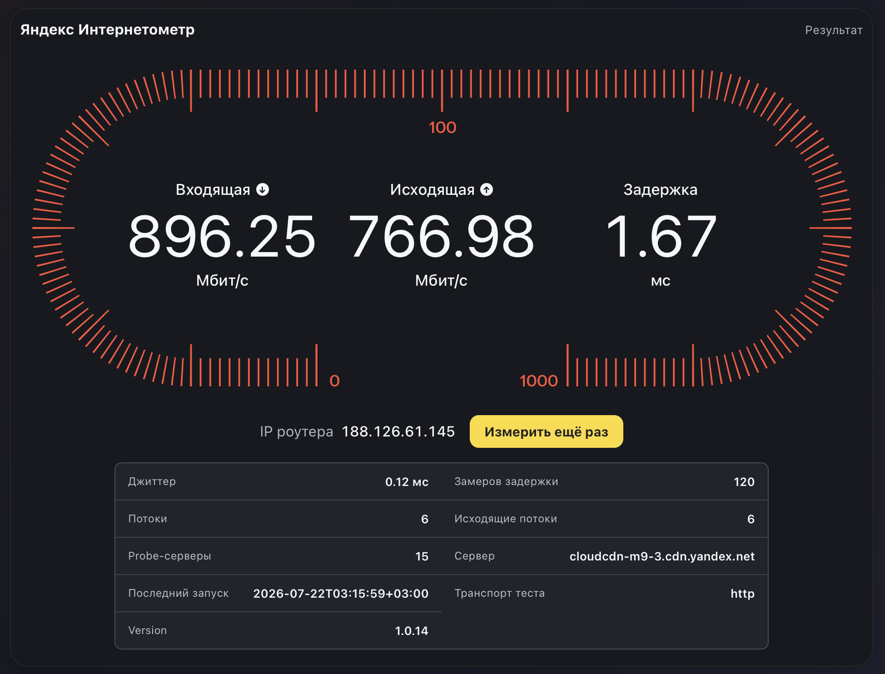

# Яндекс Интернетометр для OpenWrt

Неофициальный LuCI-интерфейс для router-side замера скорости через CDN Яндекса. Проект не связан с Яндексом.


<p align="center">
  <a href="https://github.com/sergeylopukhov/luci-app-yandex-internetometer/releases/latest"></a>
  <a href="https://openwrt.org/"></a>
  <a href="docs/install.sh"></a>
  <a href="LICENSE"></a>
</p>

## 🚀 Установка

```sh
curl -fsSL https://sergeylopukhov.github.io/luci-app-yandex-internetometer/install.sh | sh -s -- --yes
```

Без `curl`:

```sh
wget -qO- https://sergeylopukhov.github.io/luci-app-yandex-internetometer/install.sh | sh -s -- --yes
```

Откройте `LuCI → Статус → Интернетометр`. Установщик сам выбирает `apk` или `opkg`, проверяет подпись репозитория либо SHA256 IPK и сохраняет UCI-настройки.

## 📊 Что измеряет

- входящую и исходящую скорость между роутером и CDN Яндекса, а также пиковую скорость каждого этапа;
- задержку и джиттер;
- фактический транспорт и число потоков.

Этапы идут по очереди: входящая скорость, исходящая скорость, задержка, с паузой 0,5 секунды между ними. По умолчанию каждый этап скорости длится 10 секунд, задержка измеряется по 30 запросам. Скорость и задержка выводятся с двумя знаками после точки; переключатель «Дробные значения» в настройках переводит всю страницу на целые числа.

Завершённые измерения сохраняются на роутере. В LuCI можно посмотреть график за 7, 30 или 90 дней, сравнить средние показатели с предыдущим периодом и выгрузить выбранный период в CSV или JSON. В таблице рядом со средней скоростью в скобках указан пик замера. История ограничена 200 записями и не содержит публичный IP.

Из списка probe-серверов приложение выбирает ближайший: опрашивает каждый сервер для замера задержки и меряет скорость и задержку до самого быстрого. Список probe-серверов и IP роутера всегда запрашиваются по HTTPS. В режиме `auto` синтетический download/upload идёт по HTTP после проверки CDN; если HTTP недоступен, приложение переключается на HTTPS и предупреждает о возможном ограничении CPU/TLS. Пользовательские данные по HTTP не передаются: upload содержит только нули. Промежуточный узел теоретически может повлиять на тестовые данные или результат.

Замер по HTTP выполняет нативный модуль `transfer-native`: один процесс, постоянные соединения и буферы фиксированного размера. Исходящая скорость считается по счётчику принятых байтов на сервере Яндекса, а не по записи в сокет роутера. Первая секунда замера — разгон, она в результат не входит. В режиме HTTPS и на ARMv4/ARMv5 используется движок на `curl` с проверкой TLS.

Пакеты собираются отдельно для каждой архитектуры OpenWrt. При обновлении до 2.0.0 настройки потоков и протокола однократно переводятся в режим «Авто», прежние значения сохраняются в `uci show yandex-internetometer.previous`.

## 🔄 Обновление

Та же команда обновляет установленный пакет. LuCI проверяет `version.json` по HTTPS раз в шесть часов и показывает ссылку на новый выпуск. Режимы транспорта: `auto`, `http` и `https`; HTTPS подходит для диагностики и быстрого отката.

## 🛟 Если не работает

Проверьте DNS, время роутера и наличие `curl`, `jq`. На слабых роутерах router-side результат зависит от CPU, памяти и числа потоков. Для legacy `opkg` пакет рассчитан на OpenWrt 24.10; APK-ветка покрыта полнее.

История версий: [RELEASE_NOTES.md](RELEASE_NOTES.md).
